# Hack-o-Week Odd Semester Session 2026-2027

Welcome to the **Hack-o-Week** repository for the Odd Semester Session. This repository contains weekly data engineering, web applications, machine learning foundations, and analytics projects developed week-by-week.

---

## 🛠️ Global Technology Stack

---

## 🗺️ Weekly Curriculum Roadmap

```mermaid
flowchart LR
    W1["📅 Week 01-02<br><b>Student Registry Portal</b><br>• Server-rendered CRUD<br>• SQLite Database<br>• REST API Seed Integration"]
    --> W3["📅 Week 03-04<br><b>E-Commerce Analytics Engine</b><br>• Python OOP & Comprehensions<br>• NumPy Array Broadcasting<br>• Pandas Multi-Table GroupBy"]
    --> W5["📅 Week 05-06<br><b>Linear Algebra & Autograd</b><br>• Vector Norms & Dot Products<br>• Covariance & Eigendecomposition<br>• Reverse-Mode AutoDiff DAG"]
    --> W7["📅 Week 07-08<br><b>Classical Machine Learning</b><br>• Linear, Poly, Ridge, Lasso<br>• Logistic Regression & KNN<br>• Car Valuation & Deal Advisor"]
    --> W9["📅 Week 09<br><b>Evaluation & Feature Engineering</b><br>• Missing Data Imputation & Indicators<br>• Standard / MinMax / Robust Scalers<br>• Stratified CV & ROC / PR / Cost Curves"]
    --> W10["📅 Week 10<br><b>Pipelines & Clustering</b><br>• Scikit-Learn ColumnTransformer<br>• K-Means, Hierarchical & DBSCAN<br>• Persona Profiling & CRM Playbook"]
    --> W11["📅 Week 11-12<br><b>Dimensionality Reduction</b><br>• PCA Eigendecomposition & Biplot<br>• t-SNE Heavy-Tail Manifolds<br>• Reconstruction & Leaderboard"]
    --> W13["📅 Week 13-14<br><b>Ensemble Methods & Regularization</b><br>• Bagging vs Boosting (XGBoost, LightGBM)<br>• Bias-Variance Decomposition<br>• L1/L2 Shrinkage & Early Stopping"]
    --> W15["📅 Week 15-16<br><b>Neural Nets & Deployment</b><br>• NumPy MLP from Scratch & Backprop<br>• Perceptron & XOR Inseparability<br>• Optimizers & Pickle/Joblib Serving"]
```

---

## 📂 Repository Index & Subfolders

### 1. [week 01-02/](file:///e:/Hack-o-Week-Odd-Semester-Session-2026-2027/week%2001-02) — Student Registry & Database CRUD Portal
- **Description**: Server-rendered Flask web application managing academic roll lists and student profiles with zero client-side JavaScript.
- **Key Features**: Live search filtering, dynamic admission date formatting, SQLite database persistence, and RandomUser API seed integration.

### 2. [week 03-04/](file:///e:/Hack-o-Week-Odd-Semester-Session-2026-2027/week%2003-04) — Global E-Commerce Data Analytics & Visualization Engine
- **Description**: Python data engineering pipeline analyzing 397,000+ transaction records across 4,300+ customers using real relational datasets.
- **Key Features**:
  - **Python OOP & Comprehensions**: Modular architecture (`DataLoader`, `DataCleaner`, `SalesAnalyticsEngine`, `DataVisualizer`) with list/dict comprehensions.
  - **NumPy Array Vectorization & Broadcasting**: Array math (`np.multiply`), Z-score normalization `(price - mean) / std`, and RFM matrix dot products (`np.dot`).
  - **Pandas DataFrames & GroupBy**: 3-table SQL-style inner joins and multi-level GroupBy statistical aggregations.
  - **Data Visualizations**: High-resolution Seaborn and Matplotlib exports (Heatmaps, Violin Plots, Bar Charts, Line Dashboards).

### 3. [week 05-06/](file:///e:/Hack-o-Week-Odd-Semester-Session-2026-2027/week%2005-06) — Linear Algebra & Calculus Engine for Machine Learning
- **Description**: Mathematics, linear algebra, and automatic differentiation (Autograd) system built from scratch in Python applied to the Hotel Booking Demand & Cancellation dataset (119,390 records).
- **Key Features**:
  - **Linear Algebra**: Feature vector $L_2$ norms, dot product cosine similarity matrices, covariance matrix ($\mathbf{\Sigma} = \frac{1}{N-1}\mathbf{X}^T\mathbf{X}$), spectral eigendecomposition ($\mathbf{\Sigma}\mathbf{v} = \lambda\mathbf{v}$), power iteration, and 2D PCA projection.
  - **Calculus & Autograd DAG**: Custom scalar `Value` computational graph, forward activations, analytical reverse-mode automatic differentiation using the Multivariate Chain Rule, and central finite difference gradient checking ($< 10^{-10}$ error).
  - **From-Scratch Neural Network**: Multi-Layer Perceptron (MLP) trained via pure backpropagation and SGD for cancellation prediction with loss curves and decision boundary plots.
  - **Diagnostic Visualizations**: High-resolution exports (Vector similarity heatmap, Covariance scree plot, PCA projection scatter, Gradient flow validation, Decision boundary surface).

### 4. [week 07-08/](file:///e:/Hack-o-Week-Odd-Semester-Session-2026-2027/week%2007-08) — Classical Machine Learning Suite: Regression & Classification
- **Description**: Comprehensive machine learning suite covering classical Regression and Classification algorithms applied to the Used Car Resale Market Dataset (6,000 records).
- **Key Features**:
  - **Regression Suite**: Linear Regression (OLS & Normal Equation), Polynomial Regression (Degree 2, capturing non-linear depreciation and bias-variance tradeoff, $R^2 = 0.9318$), Ridge Regression ($L_2$ shrinkage), and Lasso Regression ($L_1$ coordinate descent feature sparsity).
  - **Classification Suite**: Logistic Regression (Binary Cross-Entropy, 79.92% accuracy, 0.835 ROC-AUC) and K-Nearest Neighbors (KNN with $k$-hyperparameter tuning).
  - **Real-World Decision Support**: Interactive Car Valuation & Deal Advisor evaluating specific vehicle buyer profiles and scoring deal quality.
  - **Diagnostic Visualizations**: 5 high-resolution figures (Depreciation curves, Ridge vs Lasso regularization paths, ROC/Confusion Matrix, KNN decision surface, Benchmark leaderboard).

### 5. [week 09/](file:///e:/Hack-o-Week-Odd-Semester-Session-2026-2027/week%2009) — Advanced Model Evaluation, Feature Engineering & Scaling Suite
- **Description**: Production-grade data preprocessing, leakage-free feature engineering, scaler showdown, and comprehensive evaluation system on 10,000 financial credit underwriting records.
- **Key Features**:
  - **Handling Missing Data**: Missingness diagnostics, median/mode imputation, and boolean missingness indicator flags ($I_{\text{missing}}$) to capture non-random omission signals.
  - **Feature Engineering & Outliers**: Domain interaction ratios (debt-to-income, line utilization intensity), non-linear log transformations ($\log(1+x)$), and Tukey's IQR Winsorization/capping.
  - **Feature Scaling Showdown**: Mathematical comparison of `StandardScaler` ($Z$-score), `MinMaxScaler` ($[0, 1]$), and `RobustScaler` (Median/IQR for extreme debt outliers).
  - **Comprehensive Model Evaluation**: Stratified train/test split, Stratified $k$-Fold Cross-Validation ($k=5$), Confusion Matrix (TN=982, FP=219, FN=366, TP=434), Precision, Recall, $F_1$, $F_2$, and trapezoidal ROC-AUC (0.767).
  - **Economic Threshold Optimization**: Portfolio net profit simulation tuning decision threshold $\tau$ from 0.50 to 0.15, saving $1,346,400.00 in charge-off loss.
  - **Interactive CLI & Visualizations**: Interactive underwriting risk advisor CLI and 5 publication-grade diagnostic plots in `reports/`.

### 6. [week 10/](file:///e:/Hack-o-Week-Odd-Semester-Session-2026-2027/week%2010) — Scikit-Learn Pipelines & Unsupervised Customer Segmentation
- **Description**: Complete end-to-end machine learning workflow using Scikit-Learn pipelines, column transformers, and clustering algorithms (K-Means, Hierarchical, DBSCAN) applied to retail customer behavioral data (5,000 records).
- **Key Features**:
  - **Scikit-Learn Workflow & Pipelines**: Leak-free `ColumnTransformer` coupling median imputers with `RobustScaler` (for outlier resilience) and mode imputers with `OneHotEncoder`.
  - **K-Means Clustering**: Partitioning with `k-means++` seeding, hyperparameter sweeps across $k \in [2, 10]$, Elbow Method (Inertia), and Silhouette curve maximization (optimal $k=5$, Silhouette = 0.3491).
  - **Hierarchical Agglomerative Clustering**: Bottom-up variance minimization via Ward's Linkage, full dendrogram tree pruning, and cluster assignment.
  - **DBSCAN Density Clustering**: Automated $\epsilon = 0.65$ calibration via $k$-NN knee distance heuristics ($\text{MinPts}=10$), density manifold partitioning, and isolation of 435 noise outliers (8.70%).
  - **Mathematical Tournament Benchmark**: Quantitative ranking via Silhouette Score, Davies-Bouldin Index, and Calinski-Harabasz Index.
  - **Customer Personas & Actionable CRM Strategy**: Behavioral profiling into 5 consumer personas (*VIP Whales, Careful Savers, Impulsive Trendsetters, Budget Seekers, Core Mainstream*), radar attribute footprints, and custom CRM retention playbooks.
  - **Interactive Inference & Visuals**: Real-time CLI classifier, 5 publication-grade figures in `reports/`, and fully executed Jupyter Notebook.

### 7. [week 11-12/](file:///e:/Hack-o-Week-Odd-Semester-Session-2026-2027/week%2011-12) — Dimensionality Reduction: PCA vs t-SNE Intuition & Practice
- **Description**: Comprehensive mathematical investigation and quantitative benchmark comparing linear global variance maximization (PCA) versus non-linear local manifold learning (t-SNE) on the Student Lifestyle & Academic Performance Dataset (1,000 records, 8 features, 3 academic tiers).
- **Key Features**:
  - **Principal Component Analysis (PCA)**: Standardization, covariance matrix spectral eigendecomposition ($\mathbf{\Sigma}\mathbf{v} = \lambda\mathbf{v}$), SVD, Scree plot with Kaiser criterion ($\lambda \ge 1.0$), 2D Biplot with factor loading projection arrows, and inverse reconstruction RMSE evaluation.
  - **t-Distributed Stochastic Neighbor Embedding (t-SNE)**: Probabilistic neighbor affinities ($p_{ij}$), heavy-tailed Student-t distribution ($q_{ij}$) resolving the Crowding Problem, KL divergence minimization, and perplexity sensitivity study ($\text{Perp} \in [5, 15, 30, 50]$).
  - **Quantitative Tournament Leaderboard**: Rigorous head-to-head evaluation across 2D Silhouette Score, 2D 5-NN accuracy, Trustworthiness, Spearman $\rho$ global distance rank correlation, and compute latency.
  - **Operational Tradeoffs**: Practical demonstrations of out-of-sample projection ($\mathbf{y} = \mathbf{W}^T\mathbf{x}$) and signal invertibility in PCA versus non-parametric irreversibility in t-SNE.
  - **Interactive CLI & Visuals**: Real-time CLI projection tool (`interactive_projection.py`), 5 publication-grade 300 DPI figures in `reports/`, and fully executed Jupyter Notebook.

### 8. [week 13-14/](file:///e:/Hack-o-Week-Odd-Semester-Session-2026-2027/week%2013-14) — Ensemble Methods: Bagging, Boosting (XGBoost, LightGBM) & Regularization
- **Description**: Comprehensive empirical investigation and mathematical formulation of ensemble learning paradigms (Bagging, Random Forest, AdaBoost, XGBoost, LightGBM), bias-variance decomposition, and regularization mechanisms applied to subscriber churn prediction (2,000 records).
- **Key Features**:
  - **Bias–Variance Trade-off & Decomposition**: Empirical bootstrap decomposition ($B=50$ resamples) across tree depths ($1 \to 20$) identifying high-bias underfitting, optimal generalization, and high-variance overfitting zones.
  - **Bagging Paradigm & Variance Reduction**: Mathematical and empirical proof of ensemble variance reduction ($\text{Var}(\bar{X}) = \rho \sigma^2 + \frac{1-\rho}{B}\sigma^2$), slashing variance by 87.8% (Bagging) and 94.4% (Random Forest with $m=\sqrt{d}$ feature subsampling) without increasing bias.
  - **Boosting Paradigms (XGBoost vs. LightGBM)**: 2nd-order Taylor series gradient approximations ($g_i, h_i$), leaf weight formulation, optimal split gain, and LightGBM histogram binning with leaf-wise growth (GOSS, EFB) achieving 1.6× faster training over XGBoost.
  - **Regularization & Generalization Control**: Systematic sweeps of L1 (`reg_alpha`) inducing feature sparsity, L2 (`reg_lambda`) smoothing leaf weights, and 250-round early stopping simulation avoiding a +0.0444 validation loss penalty.
  - **Interactive CLI & Visuals**: Real-time subscriber churn risk analyzer with targeted retention playbook, 5 publication-grade 300 DPI figures in `reports/`, and fully executed Jupyter Notebook.

---

### 9. [week 15-16/](file:///e:/Hack-o-Week-Odd-Semester-Session-2026-2027/week%2015-16) — Neural Networks from Scratch (NumPy) & Model Deployment Basics (Pickle/Joblib)
- **Description**: From-first-principles implementation of Deep Multi-Layer Perceptrons in pure NumPy, mathematical proofs of perceptron linear limitations, optimizer showdown (SGD, Momentum, RMSprop, Adam), finite-difference gradient checking, and production model deployment pipelines (Pickle vs. Joblib) on clinical cardiovascular risk data (1,500 records).
- **Key Features**:
  - **Perceptrons & The XOR Barrier**: Rosenblatt learning rule, step activation, and formal algebraic proof of Minsky & Papert's XOR inseparability contradiction, contrasted with 100% resolution via a 2-layer MLP.
  - **Activation Functions & Gradient Dynamics**: Mathematical formulations and analytical derivatives for Sigmoid, Tanh, ReLU, and LeakyReLU, illustrating the derivative saturation zones causing vanishing gradients.
  - **From-Scratch NumPy Neural Network**: Modular architecture supporting arbitrary topologies, He/Kaiming initialization, vectorized forward/backward passes, BCE loss, and two-sided finite-difference gradient checking confirming exactness ($\|\nabla_{\text{ana}} - \nabla_{\text{num}}\| < 10^{-7}$).
  - **Optimization Algorithms Showdown**: Head-to-head comparison of Vanilla SGD, Momentum ($\beta=0.9$), RMSprop ($\gamma=0.9$), and Adam (with bias-corrected first and second moments), demonstrating 95.0% test accuracy and 0.994 ROC-AUC.
  - **Production Model Deployment & Serving**: Packaging production `ModelDeploymentBundle` envelopes with preprocessing pipelines, metadata, and cryptographic SHA-256 verification. Benchmarking Pickle vs. Joblib (memory mapping, compression) and serving real-time predictions via a sub-millisecond microservice ($P_{50} = 0.190$ ms).
  - **Interactive CLI & Visuals**: Real-time clinical scoring CLI with internal hidden layer activation inspection, 5 publication-grade 300 DPI figures in `reports/`, and fully executed Jupyter Notebook.

---

Made by [Dhanish Ladwani](https://github.com/dhanish0711/)

