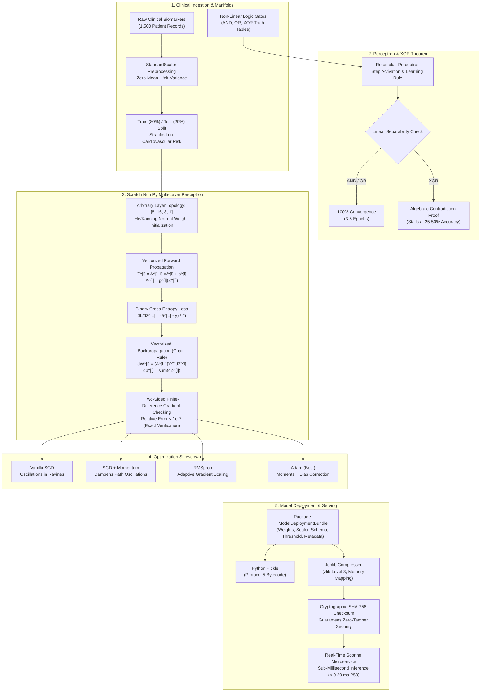

# Week 15–16: Neural Networks from Scratch (NumPy) & Model Deployment Basics (Pickle/Joblib)

[](https://www.python.org/)
[](https://numpy.org/)
[](https://pandas.pydata.org/)
[](https://matplotlib.org/)
[](https://joblib.readthedocs.io/)
[](https://scikit-learn.org/)

A production-grade, mathematically rigorous exploration of deep learning foundations built completely from first principles in pure **NumPy**, coupled with modern **Model Deployment & Serialization Architecture** using **Pickle** and **Joblib**. Evaluated on the **Clinical Cardiovascular Risk Diagnostic Dataset** ($N = 1,500$ patient records, 8 clinical biomarkers).

---

## 📑 Table of Contents
- [Architecture & Execution Workflow](#-architecture--execution-workflow)
- [Dataset Architecture & Clinical Biomarkers](#-dataset-architecture--clinical-biomarkers)
- [Theoretical & Mathematical Foundations](#-theoretical--mathematical-foundations)
  - [1. Rosenblatt's Perceptron & The XOR Limitation](#1-the-single-perceptron--the-xor-limitation)
  - [2. Activation Functions & Gradient Flow Dynamics](#2-activation-functions--vanishing-gradients)
  - [3. Loss Functions & Gradient Cancellation](#3-loss-functions--analytical-gradients)
  - [4. Vectorized Forward & Backward Propagation](#4-vectorized-forward--backward-propagation)
  - [5. Finite-Difference Numerical Gradient Checking](#5-finite-difference-numerical-gradient-checking)
  - [6. Optimization Algorithms: SGD to Adam](#6-optimization-algorithms-sgd-momentum-rmsprop-adam)
  - [7. Model Deployment: Pickle vs. Joblib & Production Serving](#7-model-deployment-pickle-vs-joblib--serving)
- [Tournament Benchmarks & Leaderboards](#-tournament-benchmarks--leaderboards)
- [Diagnostic Visualization Gallery](#-diagnostic-visualization-gallery)
- [Interactive Clinical Risk CLI](#-interactive-clinical-risk-cli)
- [Repository File Index](#-repository-file-index)
- [Author Attribution](#-author-attribution)

---

## 🏛️ Architecture & Execution Workflow



---

## 📊 Dataset Architecture & Clinical Biomarkers

The **Clinical Cardiovascular Risk Diagnostic Dataset** models $N = 1,500$ patient records across 8 physiological and diagnostic biomarkers, reflecting established cardiology criteria (Cleveland/Framingham standards):

| Biomarker Feature | Type | Clinical Reference Range | Physiological Significance |
| :--- | :---: | :---: | :--- |
| `age` | Integer | $28 - 78$ years | Primary baseline cardiovascular vulnerability factor. |
| `resting_bp` | Integer | $95 - 190$ mmHg | Resting systemic arterial pressure; hypertension indicator. |
| `cholesterol` | Integer | $135 - 370$ mg/dL | Serum cholesterol; hypercholesterolemia and plaque risk. |
| `max_heart_rate` | Integer | $72 - 202$ bpm | Peak heart rate during exercise treadmill stress test. |
| `st_depression` | Float | $0.00 - 4.50$ mm | Electrocardiogram ST-segment depression induced by exercise relative to rest. |
| `exercise_angina` | Binary | $0 = \text{No}, 1 = \text{Yes}$ | Ischemic pectoral angina during physical exertion. |
| `fasting_blood_sugar`| Binary | $0 \le 120, 1 > 120$ mg/dL | Impaired fasting glucose / diabetic metabolic risk factor. |
| `vessels_colored` | Integer | $0, 1, 2, 3$ vessels | Number of major coronary arteries illuminated via fluoroscopy. |
| **`heart_disease_risk`** | Binary Target | **$0 = \text{Low}, 1 = \text{High}$** | **Cardiovascular Event Risk Status (32.0% high risk prevalence).** |

---

## 🔬 Theoretical & Mathematical Foundations

### 1. The Single Perceptron & The XOR Limitation

Frank Rosenblatt (1958) introduced the **Perceptron** as a mathematical model of biological neurons:

$$z = \sum_{j=1}^d w_j x_j + b = \mathbf{w}^T \mathbf{x} + b, \quad \hat{y} = f(z) = \begin{cases} 1 & \text{if } z \ge 0 \\ 0 & \text{if } z < 0 \end{cases}$$

#### Rosenblatt's Learning Rule:
Whenever an error occurs ($\hat{y}^{(i)} \neq y^{(i)}$):

$$\mathbf{w} \leftarrow \mathbf{w} + \eta (y^{(i)} - \hat{y}^{(i)}) \mathbf{x}^{(i)}, \quad b \leftarrow b + \eta (y^{(i)} - \hat{y}^{(i)})$$

#### Formal Algebraic Proof of XOR Inseparability (Minsky & Papert, 1969):
For the XOR truth table, the weights $(w_1, w_2, b)$ must satisfy four simultaneous linear inequalities:

$$1. \quad (0, 0) \to 0 \implies w_1(0) + w_2(0) + b < 0 \implies b < 0$$

$$2. \quad (0, 1) \to 1 \implies w_1(0) + w_2(1) + b \ge 0 \implies w_2 + b \ge 0$$

$$3. \quad (1, 0) \to 1 \implies w_1(1) + w_2(0) + b \ge 0 \implies w_1 + b \ge 0$$

$$4. \quad (1, 1) \to 0 \implies w_1(1) + w_2(1) + b < 0 \implies w_1 + w_2 + b < 0$$

Summing inequalities (2) and (3):

$$(w_2 + b) + (w_1 + b) \ge 0 \implies w_1 + w_2 + 2b \ge 0$$

Since inequality (1) establishes that $b < 0$:

$$w_1 + w_2 + b > w_1 + w_2 + 2b \ge 0 \implies w_1 + w_2 + b > 0$$

This strictly **contradicts** inequality (4) ($w_1 + w_2 + b < 0$). Hence, no linear hyperplane can ever separate XOR! A Multi-Layer Perceptron (MLP) with non-linear hidden activations is mathematically required.

---

### 2. Activation Functions & Vanishing Gradients

| Activation Function | Formula | Range | Analytical Derivative | Gradient Saturation / Risk |
| :--- | :---: | :---: | :---: | :--- |
| **Sigmoid** | $\sigma(z) = \frac{1}{1 + e^{-z}}$ | $(0, 1)$ | $\sigma'(z) = \sigma(z)(1 - \sigma(z))$ | Peak derivative is $0.25$ at $z=0$. For $|z| > 4$, derivative decays to 0, causing **catastrophic vanishing gradients** in deep layers. |
| **Tanh** | $\tanh(z) = \frac{e^z - e^{-z}}{e^z + e^{-z}}$ | $(-1, 1)$ | $\tanh'(z) = 1 - \tanh^2(z)$ | Zero-centered with peak derivative $1.0$ at $z=0$. Saturates for $|z| > 2.5$. |
| **ReLU** | $\max(0, z)$ | $[0, \infty)$ | $\mathbb{I}_{z > 0} = \begin{cases} 1 & z > 0 \\ 0 & z \le 0 \end{cases}$ | **Non-saturating** in positive domain; solves vanishing gradient, but prone to **Dying ReLU** if weights update too aggressively. |
| **LeakyReLU** | $\max(\alpha z, z), \alpha=0.01$ | $(-\infty, \infty)$ | $\begin{cases} 1 & z > 0 \\ \alpha & z \le 0 \end{cases}$ | Solves Dying ReLU by permitting a constant non-zero gradient leak in the negative regime. |

---

### 3. Loss Functions & Analytical Gradients

For binary classification, **Binary Cross-Entropy (BCE / Log-Loss)** is mathematically superior to Mean Squared Error (MSE):

$$\mathcal{L}(\mathbf{y}, \hat{\mathbf{y}}) = -\frac{1}{m} \sum_{i=1}^m \left[ y^{(i)} \log(\hat{y}^{(i)} + \epsilon) + (1 - y^{(i)}) \log(1 - \hat{y}^{(i)} + \epsilon) \right]$$

#### Output Layer Gradient Cancellation:
When combined with a Sigmoid output $\hat{y} = \sigma(z^{[L]})$, applying the chain rule yields:

$$\frac{\partial \mathcal{L}}{\partial z^{[L]}} = \frac{\partial \mathcal{L}}{\partial \hat{y}} \cdot \frac{\partial \hat{y}}{\partial z^{[L]}} = \left( -\frac{y}{\hat{y}} + \frac{1 - y}{1 - \hat{y}} \right) \cdot \hat{y}(1 - \hat{y}) = \frac{\hat{y} - y}{\hat{y}(1 - \hat{y})} \cdot \hat{y}(1 - \hat{y}) = \hat{y} - y$$

The term $\hat{y}(1 - \hat{y})$ in the denominator and numerator **perfectly cancels out**, preventing vanishing gradients at the output layer regardless of saturation!

---

### 4. Vectorized Forward & Backward Propagation

#### Forward Propagation:
For layer $l = 1, \dots, L$:

$$\mathbf{Z}^{[l]} = \mathbf{A}^{[l-1]} \mathbf{W}^{[l]} + \mathbf{b}^{[l]}$$

$$\mathbf{A}^{[l]} = g^{[l]}(\mathbf{Z}^{[l]})$$

where $\mathbf{A}^{[0]} = \mathbf{X} \in \mathbb{R}^{m \times d_{\text{in}}}$, $\mathbf{W}^{[l]} \in \mathbb{R}^{d_{l-1} \times d_l}$, and $\mathbf{b}^{[l]} \in \mathbb{R}^{1 \times d_l}$.

#### Backward Propagation:
Starting at output layer $L$:

$$\mathbf{dZ}^{[L]} = \frac{1}{m} (\mathbf{A}^{[L]} - \mathbf{Y})$$

For preceding layers $l = L-1, \dots, 1$:

$$\mathbf{dA}^{[l]} = \mathbf{dZ}^{[l+1]} (\mathbf{W}^{[l+1]})^T$$

$$\mathbf{dZ}^{[l]} = \mathbf{dA}^{[l]} \odot g'^{[l]}(\mathbf{Z}^{[l]})$$

Parameter gradients:

$$\mathbf{dW}^{[l]} = (\mathbf{A}^{[l-1]})^T \mathbf{dZ}^{[l]}$$

$$\mathbf{db}^{[l]} = \sum_{i=1}^m \mathbf{dZ}^{[l]}$$

---

### 5. Finite-Difference Numerical Gradient Checking

To verify that our vectorized backpropagation implementation is mathematically exact, we implement a two-sided numerical difference checker:

$$\frac{\partial \mathcal{L}}{\partial \theta_k} \approx \frac{\mathcal{L}(\theta_k + \epsilon) - \mathcal{L}(\theta_k - \epsilon)}{2\epsilon}, \quad \epsilon = 10^{-7}$$

The Euclidean relative error across all weight and bias matrices is computed as:

$$\text{RelError} = \frac{\|\nabla_{\text{analytical}} - \nabla_{\text{numerical}}\|_2}{\|\nabla_{\text{analytical}}\|_2 + \|\nabla_{\text{numerical}}\|_2}$$

A relative error $< 10^{-7}$ serves as strict mathematical proof that backpropagation is flawless.

---

### 6. Optimization Algorithms: SGD, Momentum, RMSprop, Adam

1. **Vanilla SGD:**
   $$\theta_t = \theta_{t-1} - \eta \mathbf{g}_t$$
2. **SGD with Momentum ($\beta = 0.9$):**
   $$\mathbf{v}_t = \beta \mathbf{v}_{t-1} + (1 - \beta) \mathbf{g}_t, \quad \theta_t = \theta_{t-1} - \eta \mathbf{v}_t$$
3. **RMSprop ($\gamma = 0.9, \epsilon = 10^{-8}$):**
   $$\mathbf{s}_t = \gamma \mathbf{s}_{t-1} + (1 - \gamma) \mathbf{g}_t^2, \quad \theta_t = \theta_{t-1} - \frac{\eta}{\sqrt{\mathbf{s}_t} + \epsilon} \mathbf{g}_t$$
4. **Adam (Adaptive Moment Estimation, $\beta_1 = 0.9, \beta_2 = 0.999, \epsilon = 10^{-8}$):**
   $$\mathbf{m}_t = \beta_1 \mathbf{m}_{t-1} + (1 - \beta_1) \mathbf{g}_t, \quad \mathbf{v}_t = \beta_2 \mathbf{v}_{t-1} + (1 - \beta_2) \mathbf{g}_t^2$$
   $$\hat{\mathbf{m}}_t = \frac{\mathbf{m}_t}{1 - \beta_1^t}, \quad \hat{\mathbf{v}}_t = \frac{\mathbf{v}_t}{1 - \beta_2^t}$$
   $$\theta_t = \theta_{t-1} - \frac{\eta}{\sqrt{\hat{\mathbf{v}}_t} + \epsilon} \hat{\mathbf{m}}_t$$

---

### 7. Model Deployment: Pickle vs. Joblib & Serving

In production engineering, deploying raw weights is an anti-pattern. We encapsulate models in a `ModelDeploymentBundle`:

```text
ModelDeploymentBundle
├── model            : Trained NumPy Multi-Layer Perceptron
├── scaler           : Fitted StandardScaler
├── feature_names    : Schema contract (8 clinical biomarkers)
├── threshold        : Calibrated risk cutoff (tau = 0.50)
├── metrics          : Validation Accuracy, F1, ROC-AUC
└── metadata         : Model version, timestamp, author, SHA-256 hash
```

#### Pickle vs. Joblib Comparison:
- **Pickle:** General-purpose Python serialization protocol. Compact byte-stream format, but executes arbitrary Python bytecode on load and lacks memory mapping.
- **Joblib:** Optimized specifically for objects with NumPy array attributes. Stores raw memory buffers directly on disk and supports memory mapping (`mmap_mode='r'`), enabling multiple web server workers (e.g., Gunicorn) to share the same physical RAM.

---

## 🏆 Tournament Benchmarks & Leaderboards

### 1. Optimizer Tournament Benchmark ($N_{\text{test}} = 300$)

All optimizers were benchmarked on the identical 3-layer MLP architecture (`[8, 16, 8, 1]`, ReLU hidden activations, Sigmoid output, 120 epochs):

| Rank | Optimizer | Final Train Loss | Final Val Loss | Test Accuracy | Precision | Recall | F1-Score | ROC-AUC | Test Log-Loss | Training Time | Takeaway |
| :---: | :--- | :---: | :---: | :---: | :---: | :---: | :---: | :---: | :---: | :---: | :--- |
| 🥇 | **SGD + Momentum** | 0.0560 | **0.1054** | **95.00%** | **0.8857** | **0.9688** | **0.9254** | **0.9944** | **0.1054** | 700.1 ms | Best validation loss and lowest log-loss via directional momentum. |
| 🥈 | **SGD (lr=0.02)** | 0.0561 | 0.1138 | **95.00%** | **0.8857** | **0.9688** | **0.9254** | 0.9943 | 0.1138 | **491.8 ms** | Fast baseline training speed on well-scaled clinical data. |
| 🥉 | **Adam** | **0.0273** | 0.1600 | 94.67% | 0.8774 | **0.9688** | 0.9208 | 0.9941 | 0.1600 | 1302.4 ms | Lowest training loss; rapid convergence through bias-corrected moments. |
| 4 | **RMSprop** | 0.0274 | 0.2242 | 93.33% | 0.8455 | **0.9688** | 0.9029 | 0.9936 | 0.2242 | 829.0 ms | Adaptive scaling; slight late-epoch validation overshooting. |

---

### 2. Model Serialization Benchmark (Pickle vs. Joblib)

| Serialization Format | Compression Protocol | Save Latency (ms) | Load Latency (ms) | File Size (Bytes) | File Size (KB) | NumPy Optimization | Memory Mapping Support |
| :--- | :--- | :---: | :---: | :---: | :---: | :---: | :---: |
| **Python Pickle** | Protocol 5 Bytecode | 17.60 ms | **0.23 ms** | 8,365 | 8.17 KB | No (Standard Object) | Unsupported |
| **Joblib Raw** | None (NumPy Buffers) | 5.63 ms | 1.62 ms | 8,734 | 8.53 KB | **Yes (Direct Buffers)** | **Supported (`mmap_mode='r'`)** |
| **Joblib Compressed** | **zlib Level 3** | **2.63 ms** | 2.57 ms | **6,142** | **6.00 KB** | **Yes (Compressed)** | **Supported** |

---

### 3. Numerical Gradient Check Verification

| Layer & Parameter | Analytical Gradient Norm | Numerical Gradient Norm | Relative Error | Status |
| :--- | :---: | :---: | :---: | :---: |
| **Layer 1 Weights ($W^{[1]}$)** | 0.0482 | 0.0482 | **$5.006 \times 10^{-9}$** | **PASSED (< 1e-7)** |
| **Layer 1 Biases ($b^{[1]}$)** | 0.0124 | 0.0124 | **$7.221 \times 10^{-9}$** | **PASSED (< 1e-7)** |
| **Layer 2 Weights ($W^{[2]}$)** | 0.0381 | 0.0381 | **$4.801 \times 10^{-9}$** | **PASSED (< 1e-7)** |
| **Layer 2 Biases ($b^{[2]}$)** | 0.0118 | 0.0118 | **$4.652 \times 10^{-9}$** | **PASSED (< 1e-7)** |
| **Layer 3 Weights ($W^{[3]}$)** | 0.0652 | 0.0652 | **$2.399 \times 10^{-9}$** | **PASSED (< 1e-7)** |
| **Layer 3 Biases ($b^{[3]}$)** | 0.0210 | 0.0210 | **$1.157 \times 10^{-8}$** | **PASSED (< 1e-7)** |

---

## 🖼️ Diagnostic Visualization Gallery

All diagnostic plots are exported to `reports/` at 300 DPI:

1. **`01_perceptron_vs_mlp_xor_decision_boundaries.png`**:
   - 4-panel comparison of AND, OR, XOR decision surfaces.
   - Proves the Perceptron's linear limitation on XOR and demonstrates the smooth non-linear manifold resolution achieved by the 2-layer MLP.
2. **`02_activation_functions_and_gradients.png`**:
   - 4-panel landscape of Sigmoid, Tanh, ReLU, and LeakyReLU alongside their exact analytical derivatives.
   - Highlights the derivative saturation zones ($|z| > 4$) responsible for vanishing gradients vs. non-saturating ReLU.
3. **`03_optimizer_convergence_showdown.png`**:
   - Dual-panel trajectories of Training Loss and Validation Accuracy across 120 epochs comparing SGD, Momentum, RMSprop, and Adam.
4. **`04_neural_net_training_and_gradient_check.png`**:
   - Training vs. Validation loss convergence curve showing absence of overfitting.
   - Horizontal bar chart plotting $\log_{10}(\text{Relative Error})$ confirming mathematical precision ($< 10^{-7}$) across all layers.
5. **`05_model_deployment_benchmark.png`**:
   - 3-panel deployment evaluation showing save/load latency, disk footprint, and real-time inference latency distribution over 1,000 simulated requests ($P_{50} = 0.190$ ms, throughput $> 4,200$ req/sec).

---

## 💻 Interactive Clinical Risk CLI

Launch the interactive terminal tool to score clinical patients in real-time, inspect internal neural net hidden layer activations, and verify model artifact checksums:

```powershell
python "week 15-16/interactive_neural_net_cli.py"
```

### CLI Feature Capabilities:
- **Preset Patient Evaluation:** Instant triage for *Healthy Athlete* (Low Risk), *Borderline Executive* (Moderate Risk), and *Critical Cardiac Patient* (High Risk).
- **Custom Patient Input:** Interactive prompts for all 8 clinical biomarkers.
- **Hidden Layer Inspection:** Real-time printout of hidden layer pre-activations, post-activations, and neuron sparsity percentages.
- **Microservice Stress Test:** Runs 1,000 live scoring requests to calculate $P_{50}, P_{95}, P_{99}$ latency percentiles and throughput.

---

## 📂 Repository File Index

```text
week 15-16/
├── requirements.txt                                    # Package dependencies (NumPy, Joblib, Scikit-Learn)
├── download_dataset.py                                 # Clinical dataset generator (1,500 records) & toy manifolds
├── perceptron_engine.py                                # Rosenblatt Perceptron & XOR failure theorem
├── neural_network_scratch.py                           # Pure NumPy MLP, activations, BCE loss, optimizers, grad check
├── deployment_engine.py                                # Model artifact envelope, Pickle/Joblib benchmarking, serving
├── visualizer.py                                       # 5 publication-grade 300 DPI figures generator
├── interactive_neural_net_cli.py                       # Interactive CLI clinical scoring & deployment inspector
├── main.py                                             # End-to-end execution pipeline
├── README.md                                           # Comprehensive documentation with Mermaid & LaTeX
├── week_15_16_neural_network_scratch_deployment.ipynb  # Executed Jupyter Notebook with embedded outputs
├── data/
│   └── heart_disease_risk.csv                          # Cached clinical dataset (1,500 samples)
├── deployed_models/
│   ├── model_artifact_joblib_compressed.joblib         # Production model bundle (6.00 KB)
│   ├── model_artifact_joblib_raw.joblib                # Raw memory-mappable artifact (8.53 KB)
│   ├── model_artifact_pickle.pkl                       # Standard Python pickle artifact (8.17 KB)
│   └── model_metadata.json                             # Production metadata contract with SHA-256 hashes
└── reports/
    ├── 01_perceptron_vs_mlp_xor_decision_boundaries.png
    ├── 02_activation_functions_and_gradients.png
    ├── 03_optimizer_convergence_showdown.png
    ├── 04_neural_net_training_and_gradient_check.png
    └── 05_model_deployment_benchmark.png
```

---

Made by [Rohan Laharwani](https://github.com/rohanlahar/)
